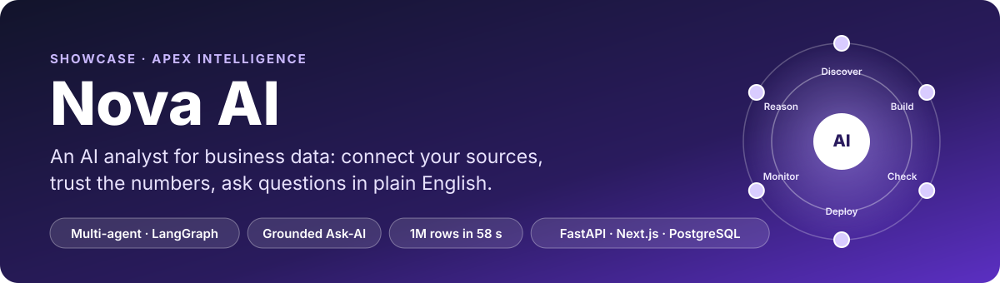
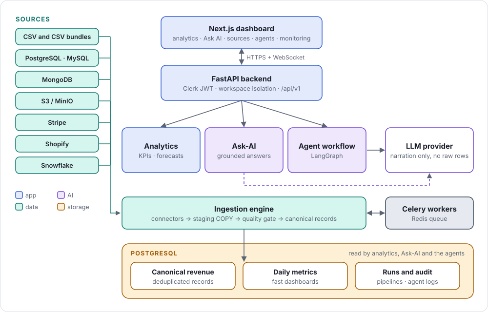
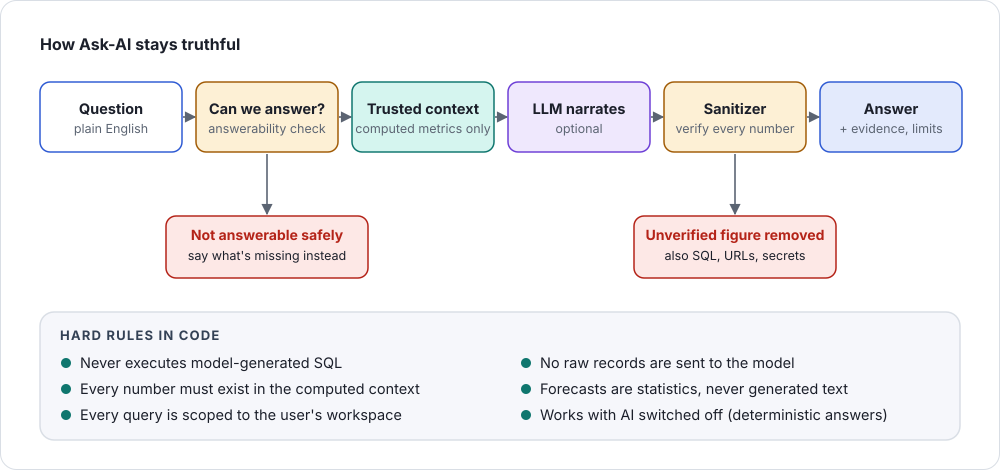
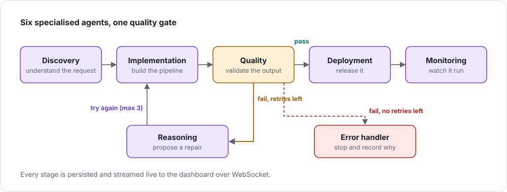
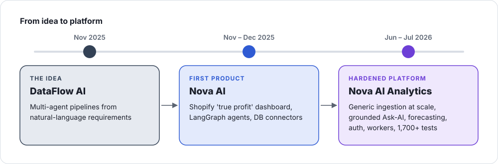

<p align="center">
  
</p>

<p align="center">
  
  
  
  
</p>

**Nova AI is an AI analyst for business data.** It connects to where a company's sales data lives
(CSV exports, databases, Stripe, Shopify, Snowflake), cleans and loads it at scale, and lets people
ask questions in plain English, with answers they can trust because **every number is computed,
not generated.**

> **About this repository.** Nova AI is a private product of Apex Intelligence. This repository is
> a **showcase**: the README, architecture, design decisions and selected code excerpts, laid out in
> the same structure as the real codebase. The full source (≈100,000 lines of Python and 15,000 of
> TypeScript) is not published. **A guided code walkthrough is available on request.**

---

## What it does

| | |
|---|---|
| 🔌 **Connect any source** | CSV files and multi-file bundles, PostgreSQL, MySQL, MongoDB, S3/MinIO, Stripe, Shopify and Snowflake, behind one small connector protocol. |
| ⚡ **Load at scale** | A staging `COPY` pipeline with a quality gate and idempotent reruns: **1 million rows in 58.5 seconds** in local benchmarks. |
| 💬 **Ask in plain English** | "Which category drove revenue this quarter?" Answers come with evidence, limitations and suggested charts, or an honest "not enough data yet". |
| 📈 **Forecast honestly** | 90-day, 1-year and long-term forecasts with confidence bands, only when there is enough history. Statistics, not generated text. |
| 🤖 **Automate pipelines with agents** | Six specialised agents in a LangGraph workflow build, check, deploy and monitor data pipelines, with a quality gate and an automatic repair loop. |
| 🛡️ **Built for teams** | Clerk authentication, workspace isolation on every query, background workers, live status over WebSocket. |

## Architecture

<p align="center"></p>

## How the AI stays truthful

The core design idea: **a language model may narrate the numbers, but it never produces them.**

<p align="center"></p>

The sanitizer is shown in full in [`nova_ai/services/llm_output_sanitizer.py`](nova_ai/services/llm_output_sanitizer.py),
with its tests in [`tests/`](tests/).

## The agent workflow

<p align="center"></p>

## Tech stack

| Layer | Technologies |
|---|---|
| **Backend** | Python, FastAPI, Pydantic v2, SQLAlchemy 2 (async, asyncpg), Alembic |
| **AI** | LangGraph, LangChain, OpenAI, Groq or any OpenAI-compatible provider (switchable by configuration), Anthropic client for agents, deterministic grounding and sanitising |
| **Data** | PostgreSQL, staging `COPY` ingestion, Pandas, NumPy, scikit-learn (Isolation Forest anomaly detection), statistical forecasting |
| **Workers** | Celery, Redis |
| **Frontend** | Next.js 16, React 19, TypeScript, Tailwind CSS, Radix UI, Recharts, React Flow, Framer Motion |
| **Security** | Clerk (JWT), workspace isolation, webhook signature checks, secret-safe logging |
| **Quality** | pytest (**1,700+ automated tests**), Playwright end-to-end tests, Ruff, Black, Mypy, load tests |
| **Delivery** | Docker, GitHub Actions deploy workflows (Render, AWS, previews), Sentry |

## From idea to platform

<p align="center"></p>

Built in 66 documented phases. Each phase ended with a written audit of what was proven, what was
only tested locally, and what still needed a live environment.

## What's in this repository

The folders mirror the real codebase. Every code file is a clearly marked excerpt.

```
nova-ai-showcase/
├── orchestration/workflow.py              LangGraph graph: state, wiring, quality-gated retry loop
├── agents/base_agent.py                   The contract every agent implements
├── nova_ai/
│   ├── services/
│   │   ├── ask_ai_service.py              One Ask-AI turn: hard rules and flow
│   │   ├── analyst_answerability.py       "Can this be answered safely?" before any model call
│   │   ├── llm_output_sanitizer.py        Complete: removes SQL, secrets and unverified numbers
│   │   └── forecast_service.py            Horizon rules, method choice, confidence bands
│   └── ingestion/
│       ├── contracts/connector_protocol.py  Complete: the connector interface
│       └── high_scale/copy_loader.py        PostgreSQL COPY path behind the benchmark
├── tests/test_verified_metric_sanitizer.py  Complete: real tests for the sanitizer
├── frontend/README.md                     Dashboard stack and screens
├── docs/
│   ├── DESIGN_DECISIONS.md                The seven choices that shaped Nova AI
│   └── BENCHMARK.md                       Ingestion benchmark and what made it fast
└── tools/make_showcase_svgs.py            Generates the diagrams above
```

## Status

Built and tested locally as a deployment-ready SaaS candidate: migrations, authentication,
workers, connectors and the full test suite pass locally. A public production deployment is the
next step. Connector status is reported per source: some are validated against live test
accounts, others only through automated tests.

## Team

Designed and led by **[Lamjed Lounissi](https://github.com/lounissi1)** (architecture, AI design,
backend and data), with the support of a development intern.
Built at **Apex Intelligence**.

Questions or a code walkthrough: reach out on [LinkedIn](https://www.linkedin.com/in/lamjed-lounissi).

## License

© Apex Intelligence. All rights reserved. The code in this repository is shown for demonstration
only; it may not be copied, modified or redistributed. See [LICENSE](LICENSE).
